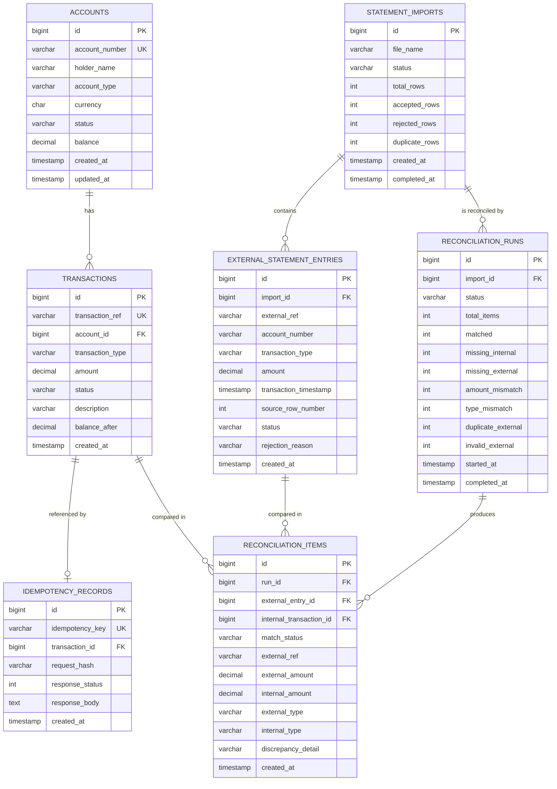

# BankRecon — Entity Relationship Diagram

Rendered from the Flyway migrations in `src/main/resources/db/migration`.

## Cardinalities

| Relationship | Cardinality | Notes |
|--------------|-------------|-------|
| `accounts` → `transactions` | 1 : N | One account has many transactions. |
| `transactions` → `idempotency_records` | 1 : 0..1 | A transaction may be referenced by one idempotency record. |
| `statement_imports` → `external_statement_entries` | 1 : N | One upload produces many parsed rows. |
| `statement_imports` → `reconciliation_runs` | 1 : N | An import can be reconciled multiple times over time. |
| `reconciliation_runs` → `reconciliation_items` | 1 : N | One run produces one item per compared record. |
| `external_statement_entries` → `reconciliation_items` | 1 : N | Optional link (`external_entry_id` nullable). |
| `transactions` → `reconciliation_items` | 1 : N | Optional link (`internal_transaction_id` nullable). |
